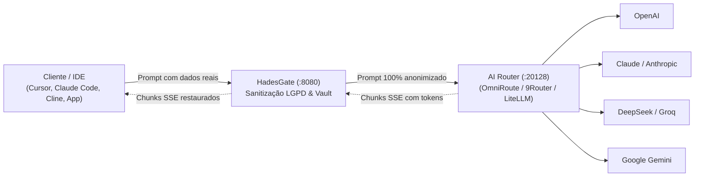

# Guia de Integração: HadesGate + AI Routers (OmniRoute, 9Router, LiteLLM)

Este documento descreve a arquitetura, configuração e boas práticas para executar o **HadesGate** em conjunto com **AI Routers** e Gateways de Modelos (como **OmniRoute**, **9Router**, **LiteLLM**, **OneRoute** e **Portkey**).

---

## 1. Visão Geral e Papéis Complementares

O ecossistema moderno de IA corporativa frequentemente divide as responsabilidades em duas camadas essenciais:

| Camada | Ferramenta | Responsabilidade Principal |
|---|---|---|
| **Privacidade & Compliance LGPD** | **HadesGate** | Intercepta o prompt, detecta e substitui PIIs e segredos sensíveis (CPF, CNPJ, PIX, Cartão, IBAN, RG, CNH, Nomes, API Keys) por tokens temporários em microssegundos (< 0.04 ms), mantendo os valores reais apenas em memória RAM efêmera. Desanonimiza as respostas em streaming SSE via algoritmo de janela deslizante (*Sliding Window*). |
| **Roteamento & Otimização** | **OmniRoute / 9Router / LiteLLM** | Agrega dezenas de provedores e modelos (OpenAI, Claude, Gemini, DeepSeek, Groq, Llama, Ollama), executa fallbacks automáticos em caso de rate limit e gerencia cotas de equipes. |

Juntas, essas ferramentas formam uma solução completa: **Máxima conectividade multi-provedor sem qualquer vazamento de dados confidenciais para as IAs**.

---

## 2. Arquitetura Recomendada: HadesGate como Borda de Segurança

A topologia recomendada posiciona o **HadesGate na linha de frente**, recebendo todas as requisições das ferramentas e clientes (Cursor, Claude Code, Cline, scripts, microsserviços), sanitizando os dados e encaminhando o tráfego limpo para o roteador.



---

## 3. Formas de Configuração

### Cenário A: OmniRoute / 9Router Rodando no Host (Fora do Docker)

No arquivo `.env` do HadesGate:

```dotenv
OPENAI_BASE_URL=http://host.docker.internal:20128/v1
OPENAI_API_KEY=sua_chave_do_omniroute
HADESGATE_ADMIN_KEY=hadesgate_sec_admin_key_2026
```

### Cenário B: Orquestração Unificada com Docker Compose

```yaml
name: ai-infrastructure

services:
  hadesgate:
    build: .
    container_name: hadesgate
    ports:
      - "8080:8080"
    environment:
      - PORT=8080
      - HADESGATE_ADMIN_KEY=seu_segredo_hadesgate
      - OPENAI_BASE_URL=http://omniroute:20128/v1
      - OPENAI_API_KEY=${OMNIROUTE_API_KEY:-}
      - VAULT_TTL=10m
    depends_on:
      - omniroute
    restart: unless-stopped

  omniroute:
    image: omniroute/omniroute:latest
    container_name: omniroute
    ports:
      - "20128:20128"
    volumes:
      - ./omniroute-data:/app/data
    environment:
      - PORT=20128
    restart: unless-stopped
```

### Cenário C: Roteamento Dinâmico por Requisição (Headers HTTP)

```env
HADESGATE_ALLOW_DYNAMIC_UPSTREAM=true
HADESGATE_DYNAMIC_UPSTREAM_ALLOWED_HOSTS=host.docker.internal:20128,omniroute:20128
```

| Header | Descrição | Exemplo |
|---|---|---|
| `X-Upstream-Url` | Sobrescreve a URL somente quando o recurso está habilitado e o host exato está na allowlist | `http://host.docker.internal:20128/v1` |
| `X-Upstream-Key` | Informa a chave que deve ser enviada para o upstream (OmniRoute/9Router) | `Bearer sk-minha-chave-router` |
| `X-HadesGate-Request-ID` | ID seguro retornado pelo gateway para correlação operacional | `req_a1b2...` |

---

## 4. Segurança de Credenciais e Isolamento

- **Proteção da `HADESGATE_ADMIN_KEY`**: Se o cliente autenticar no HadesGate via `Authorization: Bearer <HADESGATE_ADMIN_KEY>`, o HadesGate **nunca repassa esse token** para o roteador ou para a OpenAI. Ele substitui automaticamente pela chave configurada em `OPENAI_API_KEY` ou pelo header `X-Upstream-Key`.
- **Proteção contra SSRF**: URLs dinâmicas são bloqueadas por padrão, exigem allowlist exata, aceitam somente HTTP(S), rejeitam userinfo/query/fragment e não seguem redirects automáticos.

---

## 5. Configuração em Ferramentas de Desenvolvimento

### No Cursor IDE / Claude Code / Cline
- **Base URL**: `http://localhost:8080/v1`
- **API Key**: Sua `HADESGATE_ADMIN_KEY` configurada no `.env`.

### No SDK Oficial da OpenAI (Python)
```python
from openai import OpenAI

client = OpenAI(
    base_url="http://localhost:8080/v1",
    api_key="sua_chave_hadesgate"
)

response = client.chat.completions.create(
    model="claude-3-5-sonnet",
    messages=[
        {"role": "user", "content": "Emita o recibo para Carlos Eduardo, CPF 333.444.555-66."}
    ],
    stream=True
)

for chunk in response:
    if chunk.choices[0].delta.content:
        print(chunk.choices[0].delta.content, end="", flush=True)
```
O console exibirá o nome e o CPF reais restaurados, enquanto os servidores do provedor de IA e do roteador viram apenas tokens namespaced como `[HG_a1b2c3d4e5f6_PERSON_1]` e `[HG_a1b2c3d4e5f6_CPF_1]`.
